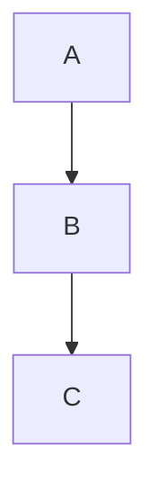

# Documentation Rules

> **Scope**: the `docs/` directory and all Markdown documents
> **Priority**: Strong recommendation - strongly advised to follow

---

## Documentation Truthfulness Principle

### No Premature Documentation
- Prohibited: writing feature description documents before the code is implemented
- Prohibited: writing detailed API documentation before the architecture design
- Prohibited: recording unverified assumptions or plans

### Documentation Must Reflect the Actual State
- Must: documentation describes features that are already implemented
- Must: API documentation matches the actual code
- Must: architecture diagrams reflect the current system state

### Verification Mechanism
- Verify with the `verification-before-completion` Skill
- Documentation PRs must include the corresponding code changes
- Audit documentation-code consistency periodically

---

## Research Document Standards

### Must Contain Verbatim Citations

Research documents stored in `docs/research/` **must** include:

1. The official documentation URL
2. The date accessed
3. **Verbatim excerpts** of key configuration/API text (not screenshots)
4. Official example code (copied directly)

### Format Example

````markdown
# DSH Tool Guard Configuration

**Source**: `@deepseek-ai/dsh-tools` README (installed with DSH)
**Accessed**: 2026-10-18

## Official Configuration Format (verbatim excerpt)

DSH has no JSON hook configuration file; write interception is registered by a host plugin through `ctx.tools.guard()`:

```js
ctx.tools.guard((exec) => {
  if (exec.name !== 'write' && exec.name !== 'edit') return undefined;
  return 'Reason: this write requires confirmation through a gate first';
});
```

The plugin's `tools/post-execute` event can invalidate downstream gate state after a successful write.
````

**Prohibited**:
- Prohibited: writing configuration from memory or guesses
- Prohibited: using screenshots in place of verbatim text
- Prohibited: omitting the source of the information

---

## Document Structure Standards

### Design Documents

```markdown
# Design Title

> **Status**: Draft/Reviewed/Implemented  
> **Date**: YYYY-MM-DD  
> **Author**: Author name

## Background

Why is this design needed? What problem does it solve?

### Option Comparison

- **Option A**: strengths ..., weaknesses ..., applicable scenarios ...
- **Option B**: strengths ..., weaknesses ..., applicable scenarios ...

## Final Approach

Which option is chosen? Why?

## Architecture Design



## Implementation Plan

- [ ] Task 1
- [ ] Task 2

## References

- [Link 1](url)
- [Link 2](url)
```

### API Documents

```markdown
# API Name

## Interface Definition

```typescript
interface ApiResponse<T> {
  success: boolean;
  data?: T;
  error?: string;
}
```

## Usage Example

```typescript
const result = await api.getData();
```

### Error Handling

- **400**: invalid request parameters — check the parameter format
- **500**: internal server error — retry or contact support
```

---

## Markdown Formatting Standards

### Heading Levels
- Use `#` through `###` (at most 3 levels)
- Leave a blank line after a heading
- Do not add blank lines around headings

### Code Blocks
- Always specify the language: ```typescript, ```bash
- Add comments to complex code
- Keep code executable (not pseudocode)

### Tables
- Separate the header from the content with `|---|`
- Keep alignment consistent
- Consider lists for complex tables

### Lists
- Use `-` rather than `*`
- Indent sublists by 2 spaces
- Keep list items grammatically parallel

---

## Documentation Maintenance

### Update Frequency
- Update documentation immediately after a feature change
- Audit documentation accuracy monthly
- Mark outdated documentation as `@deprecated`

### Version Control
- Commit documentation together with code
- Bump the documentation version on major changes
- Preserve historical version records

### Documentation Review
- PRs must include documentation updates (where applicable)
- Important documents require review
- Clean up expired documents periodically

---

## Documentation Type Guide

### Design documents (docs/design/)
- Architecture design, technical approaches
- Must include an option comparison
- Record the rationale for decisions

### Guide documents (docs/guides/)
- Usage guides, best practices
- Include complete examples
- Steps are clear and executable

### API documents (docs/api/)
- Interface definitions, parameter descriptions
- Usage examples, error handling
- Keep consistent with the code

### Research documents (docs/research/)
- Technology research, tool comparisons
- Must include verbatim citations
- Cite the source of information

---

## Writing Style

### Language
- Keep technical terms in English (API, Skill, Agent)
- Use Chinese for explanatory text
- Keep code blocks in English

### Tone
- Describe objectively; avoid subjective judgment
- Use "recommended" rather than "must" (unless it is a rule)
- Provide context and rationale

### Examples
- Incorrect: "This approach is excellent, strongly recommended". Correct: "Option A performs better under high concurrency (P99 latency reduced by 40%); recommended when QPS > 1000"
- Incorrect: "Everyone knows...". Correct: "According to the official documentation (source URL), the configuration format is as follows..."

---

> **Important**: Documentation is the project's knowledge base; its quality directly affects team collaboration efficiency.
