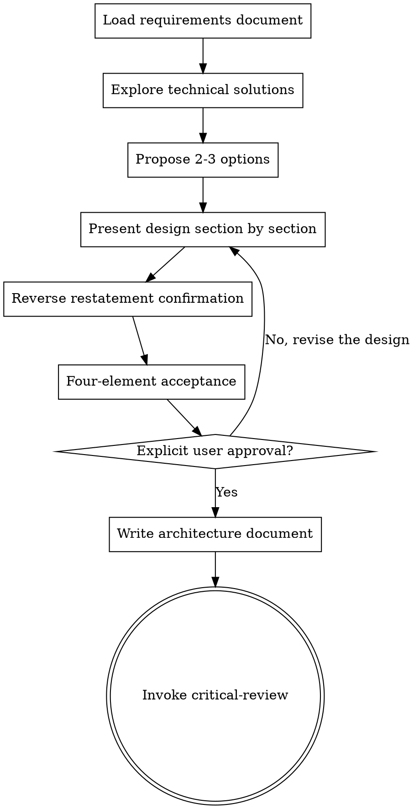

# Architecture Design

## Purpose

Use this Skill for architecture design after the requirements document is complete and approved by the user.

**Trigger conditions**:
- The requirements document has passed critical-review
- The user explicitly instructs to enter the architecture design phase
- Technical solution selection and architecture design are needed

<HARD-GATE>
Before the architecture design document is complete and explicitly approved by the user, writing code or entering the implementation phase is prohibited.
</HARD-GATE>

---

## Core Flow



---

## Process Details

### 1. Load the Requirements Document

**Goal**: Understand the approved requirements

**Actions**:
- Read `docs/requirements/YYYY-MM-DD-{topic}-requirements.md`
- Read the terminology definitions in `CONTEXT.md`
- Confirm the requirements document has passed critical-review
- Identify core requirements and constraints

---

### 2. Explore Technical Solutions

**Goal**: Research feasible technical implementation paths

**Actions**:
- Analyze the technical challenges of the requirements
- Research available technical solutions and tools
- Consider the technology stack constraints of the existing system
- Evaluate team technical capability

---

### 3. Propose 2-3 Options

**Goal**: Explore different implementation paths and present a trade-off analysis

**Format**:

#### Option A: {option name} (Recommended)
- **Description**: One-sentence description
- **Pros**: 2-3
- **Cons**: 1-2
- **When to use**: When to choose this option

#### Option B: {option name}
- **Description**: One-sentence description
- **Pros**: 2-3
- **Cons**: 1-2
- **When to use**: When to choose this option

#### Option C: {option name}
- (Same as above)

**Recommendation statement**:
"I recommend Option A because {specific reason}. What do you think?"

---

### 4. Present the Design Section by Section

**Goal**: Validate incrementally and avoid presenting an oversized design all at once

**Section structure** (adjust as needed):

#### Section 1: Architecture Overview
- High-level architecture diagram (text description or ASCII art)
- Core components and their relationships
- Data flow direction

**Ask**: "Is this architectural direction correct?"

#### Section 2: Core Components
- Responsibility of each component
- Interface definitions (**must follow the deep module principle**)
  - Number of interface methods ≤ 5
  - Depth ratio ≥ 10:1
- Dependencies

**Deep module design example**:
```typescript
// ✅ Deep module: small interface + large implementation
interface OrderService {
  submitOrder(dto: SubmitOrderRequest): OrderResult;  // 1 interface
  cancelOrder(id: string, reason: string): void;      // 2 interfaces
  // The internal implementation contains 10+ pieces of logic, but callers only need to know these 2 methods
}
```

**Ask**: "Is the component breakdown reasonable? Are the interfaces simple enough?"

#### Section 3: Data Model
- Core Entity/Value Object
- Relationship definitions
- Key constraints

**Ask**: "Does the data model cover all scenarios?"

#### Section 4: Error Handling
- Failure scenarios
- Retry strategy
- Fallback plan

**Ask**: "Is the error handling strategy appropriate?"

#### Section 5: Test Strategy
- Unit test coverage points
- Integration test scenarios
- Edge case testing

**Ask**: "Is the test strategy sufficient?"

---

### 5. Reverse Restatement Confirmation

**Goal**: Verify that the AI's understanding matches the user's intent

**Actions**:

The AI must restate the following, and the user confirms each item:

```markdown
Let me confirm my understanding:

1. The architecture pattern we are adopting is: {architecture pattern}
2. The main components include: {core components}
3. The key technology choices are: {technology choices}
4. The data flow is: {data flow}
5. The risks to watch are: {main risks}
6. We chose this option because: {reasons for the choice}

Is my understanding correct? Anything missing or wrong?
```

**User response**:
- ✅ Completely correct → Proceed to four-element acceptance
- ⚠️ Mostly correct, but... → Continue after clarification
- ❌ Several things are wrong → Return to the design phase

---

### 6. Four-Element Acceptance

**Goal**: Ensure the architecture document meets quality standards

#### Element 1: Architecture Design Completeness
- [ ] Architecture overview (high-level diagram + core components + data flow) ✅
- [ ] Core component design (responsibilities + interfaces + dependencies) ✅
- [ ] Data model (Entity/Value Object + relationships + constraints) ✅
- [ ] Error handling strategy (failure scenarios + retry + fallback) ✅
- [ ] Test strategy (unit tests + integration tests + edge case tests) ✅
- [ ] Each section received the user's confirmation that it "looks right"

**Quantitative metrics**:
- Design section coverage = **must be 100%** (5/5 sections)
- User confirmations per section = **must be 5**

#### Element 2: Design Traceability
- [ ] Every architecture decision can be traced to a specific item in the requirements document
- [ ] No gold-plated features (YAGNI check: a design that cannot be traced to a requirement = gold-plating)
- [ ] Every requirement is supported by at least one architecture component (no missed requirements)

**Quantitative metrics**:
- Design traceability rate = design decisions with requirement support / total design decisions = **must be 100%**
- Requirements coverage rate = requirements with architecture support / total requirements = **must be 100%**
- Number of gold-plated features = **must be 0**

#### Element 3: Risks Communicated
- [ ] At least 2 technical risks identified (simple requirements) or 3-5 (complex requirements)
- [ ] Each risk includes: description, impact level (high/medium/low), mitigation strategy
- [ ] Dependency risks identified (external systems, third-party libraries, team dependencies)
- [ ] The user confirms understanding of all high-risk items

**Quantitative metrics**:
- Number of technical risks identified ≥ **2**
- User confirmation rate for high-risk items = **must be 100%**

#### Element 4: Explicit Approval
- [ ] The user approves using one of the following explicit statements:
    ✅ "I approve this architecture design document"
    ✅ "The architecture design is confirmed, you can start writing the implementation plan"
    ✅ "Approved" / "I approve"
  
- [ ] Vague confirmations are not accepted:
    ❌ "OK" / "Alright" / "Sure" / "Mm"
    ❌ A thumbs-up emoji alone
    ❌ Silence (no reply for more than 2 minutes)

---

### 7. Write the Architecture Document

**Goal**: Persist the approved design

**File location**: `docs/plans/YYYY-MM-DD-{topic}-design.md`

**Architecture document structure**:
```markdown
# {Feature name} Architecture Design Document

## Overview
One-sentence description

## Requirements Traceability
- Based on the requirements document: `docs/requirements/YYYY-MM-DD-{topic}-requirements.md`
- Requirements coverage:

## Option Selection
- Option A (recommended): {reason}
- Option B: {why not chosen}
- Option C: {why not chosen}

## Architecture Design

### Architecture Overview
{high-level architecture diagram + core components + data flow}

### Core Components
{component responsibilities + interface definitions + dependencies}

### Data Model
{Entity/Value Object + relationships + constraints}

### Error Handling
{failure scenarios + retry strategy + fallback plan}

### Test Strategy
{unit tests + integration tests + edge case tests}

## Architecture Principles

### Deep Module Requirements
All core modules must be deep modules and follow these rules:
1. **Number of interface methods** ≤ 5
2. **Depth ratio** ≥ 10:1 (internal logic : interface methods)
3. **Caller-friendly**: Callers only need to know a small number of interfaces
4. **Knowledge concentration**: Related logic is concentrated inside the module

**Deletion Test**:
Imagine deleting the module:
- ❌ If the complexity disappears → it is just a pass-through layer (shallow, should be deleted or merged)
- ✅ If the complexity reappears across N callers → it has value (deep, keep it)

## Technical Risks
{identified technical risks and mitigation strategies}

## Terminology Updates
{list any new terms and update CONTEXT.md}
```

---

### 8. Transition to Critical Review

**Next step**: Invoke `sg-skill-critical-review` for an independent review

**The AI must follow**:
1. The architecture document has been committed to git
2. CONTEXT.md has been updated (if there are new terms)
3. Invoke critical-review for critical review

**Prohibited**:
- ❌ Writing code directly
- ❌ Skipping the critical review
- ❌ Entering the implementation phase

---

## Anti-Patterns

### Anti-Pattern 1: Skipping Option Comparison

**Wrong**: Give one option directly and start designing

**Correct**: Must propose 2-3 options and analyze the trade-offs

---

### Anti-Pattern 2: Presenting the Entire Design at Once

**Wrong**: Output a complete 5,000-word architecture design in one go

**Correct**: Present section by section, and continue only after each section is confirmed by the user

---

### Anti-Pattern 3: Gold-Plating

**Wrong**: Adding features that are not in the requirements "just in case"

**Correct**: Strictly follow the YAGNI principle and implement only what the requirements explicitly demand

---

### Anti-Pattern 4: Untraceable Design

**Wrong**: Architecture decisions cannot be traced to specific requirements

**Correct**: Every design decision must state which requirement in the requirements document it satisfies

---

## Key Principles

1. **Requirements-driven** — All design decisions trace back to requirements
2. **Option comparison** — Always propose 2-3 options and analyze the trade-offs
3. **Incremental validation** — Present the design section by section, obtaining approval for each
4. **Deep modules** — Simple interfaces, rich implementations
5. **Reverse restatement** — Restate your understanding in your own words to ensure alignment
6. **Four-element acceptance** — Completeness, traceability, risk communication, explicit approval
7. **Strict YAGNI** — Remove all gold-plated features
8. **Critical review** — The architecture document must undergo independent review once complete

---

## Red Lines

- ❌ Starting the design without loading the requirements document
- ❌ Skipping option comparison
- ❌ Presenting the entire design at once
- ❌ Adding gold-plated features
- ❌ Untraceable design
- ❌ Entering the next phase without explicit approval
- ❌ Skipping the critical review
- ❌ Approving when the four-element acceptance has not passed

---

## Relationship with Other Skills

| Skill | Relationship | Description |
|-------|--------------|-------------|
| **requirements-definition** | Prerequisite | Requirements definition must be completed and approved first |
| **critical-review** | Follow-up invocation | The only permitted step after the architecture document is approved |
| **domain-modeling** | Optional invocation | Invoke during design if DDD modeling is needed |
| **harness-design** | Optional invocation | Invoke during design if a seven-layer architecture review is needed |
| **writing-plans** | Follow-up invocation | Entered after critical-review passes |

---

**The final state is invoking critical-review.** Before the architecture document is complete and explicitly approved by the user, entering the implementation phase is prohibited.
