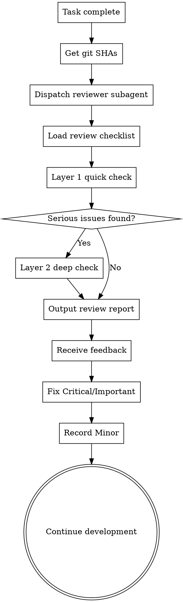

# Code Review

Dispatch the sg-agent-reviewer subagent to perform a code review, catching problems before they spread.

**Core principle:** Review early, review often. Independent context, objective review.

---

## When to Request a Review

**Mandatory:**
- After each task in subagent-driven development is complete
- After completing a major feature
- Before merging into the main branch

**Optional but valuable:**
- When stuck (a fresh perspective)
- Before refactoring (baseline check)
- After fixing a complex bug

---

## Review Flow



---

## How to Request

### 1. Get the git SHAs

```bash
BASE_SHA=$(git rev-parse HEAD~1)  # or origin/main
HEAD_SHA=$(git rev-parse HEAD)
```

### 2. Dispatch the sg-agent-reviewer Subagent

Use the Task tool, select the sg-agent-reviewer Agent, and provide the following information:

**Required parameters:**
- `{WHAT_WAS_IMPLEMENTED}` — what you just implemented
- `{PLAN_OR_REQUIREMENTS}` — what it should do (requirements/plan reference)
- `{BASE_SHA}` — starting commit
- `{HEAD_SHA}` — ending commit
- `{DESCRIPTION}` — brief description

### 3. The Agent Performs the Review

sg-agent-reviewer will:
1. Load the `code-review-checklist.md` review checklist
2. Perform the Layer 1 quick check (P0/P1/P2)
3. If serious issues are found, trigger the Layer 2 deep check
4. Output the review report to `.specgate/reviews/review-feedback.md`

### 4. Act on the Feedback

**Critical level (must fix):**
- Fix immediately
- Re-run tests
- Review again

**Important level (should fix):**
- Fix before continuing
- If there is a specific reason not to fix, document the rationale

**Minor level (fix recommended):**
- Record in the technical debt list
- Handle in a later iteration

**If the reviewer is wrong:**
- Rebut with technical reasoning
- Provide code/tests proving that it works
- Request clarification

---

## Example

```
[Just finished task 2: add validation functions]

You: Let me request a code review before continuing.

BASE_SHA=$(git log --oneline | grep "Task 1" | head -1 | awk '{print $1}')
HEAD_SHA=$(git rev-parse HEAD)

[Dispatch the sg-agent-reviewer subagent]
  WHAT_WAS_IMPLEMENTED: Validation and repair functions for the conversation index
  PLAN_OR_REQUIREMENTS: Task 2 from docs/plans/deployment-plan.md
  BASE_SHA: a7981ec
  HEAD_SHA: 3df7661
  DESCRIPTION: Added verifyIndex() and repairIndex(), covering 4 issue types

[Subagent returns the review report]:
  Strengths:
    - Clear architecture with good separation of responsibilities
    - Comprehensive test coverage (18 test cases)
    - Solid error handling
  
  Issues:
    Important: missing progress indicator
      - File: indexer.ts:130
      - Impact: users cannot tell the progress of the operation
      - Suggestion: add an "X of Y" counter
    
    Minor: magic number (100)
      - File: indexer.ts:85
      - Suggestion: extract to a named constant
  
  Assessment: can continue after fixing Important

You: [Add progress indicator]
[Re-run tests, all pass]
[Continue with task 3]
```

---

## Integration with the Workflow

### Subagent-Driven Development
- Review after each task completes
- Catch issues before they accumulate
- Fix before moving to the next task

### Executing Plans
- Review after each batch (3 tasks) completes
- Get feedback, apply fixes, continue execution

### L1 Lightweight Changes
- Automatically trigger the review when coding is complete
- Quick check, completed in 5-10 minutes

### L2/L3 Medium and Large Changes
- Layer 1 quick check
- Trigger the Layer 2 deep check based on the issues found
- Full review report and feedback loop

---

## Principles for Receiving Review Feedback

**Technical validation, not emotional performance:**

```
After receiving review feedback:

1. Read: read the feedback completely without reacting
2. Understand: restate the request in your own words (or ask)
3. Verify: check against the actual state of the codebase
4. Evaluate: is it technically sound for this codebase?
5. Respond: technical confirmation or a well-reasoned rebuttal
6. Implement: one item at a time, testing each
```

### Prohibited Responses

**Never:**
- ❌ "You're completely right!" (performative agreement)
- ❌ "Good point!" / "Excellent feedback!" (emotional performance)
- ❌ "Let me implement that now" (before verifying)

**Instead:**
- ✅ Restate the technical requirement
- ✅ Ask clarifying questions
- ✅ If it is wrong, rebut with technical reasoning
- ✅ Get straight to work (actions > words)

### When to Push Back

Push back in the following cases:
- The suggestion would break existing functionality
- The reviewer lacks full context
- It violates the YAGNI principle (unneeded features)
- It is technically incorrect for the current tech stack
- There are legacy/compatibility reasons

**How to push back:**
- Base it on technical grounds, not defensiveness
- Ask specific questions
- Cite working tests/code
- Involve the user if it is an architectural issue

---

## Red Flags

**Never:**
- ❌ Skip the review because "it's simple"
- ❌ Ignore Critical level issues
- ❌ Continue while Important level issues are unfixed
- ❌ Argue with valid technical feedback

**If the reviewer is wrong:**
- Rebut with technical reasoning
- Show code/tests proving that it works
- Request clarification

---

## Relationship with Other Skills

| Skill | Relationship | Description |
|-------|--------------|-------------|
| **sg-skill-test-driven-development** | Prerequisite | TDD ensures test coverage and provides a safety net for review |
| **sg-skill-executing-plans** | Integration | Triggers code review after each batch completes |
| **sg-skill-critical-review** | Parallel | Document review uses critical-review; code review uses code-review |
| **sg-skill-systematic-debugging** | Follow-up | Issues found in review may require systematic debugging |

---

## Review Checklist Reference

For the detailed review checklist, see: [code-review-checklist.md](code-review-checklist.md)

**Two-layer check mechanism:**
- **Layer 1 (mandatory)**: quick checklist, completed in 5-10 minutes
- **Layer 2 (on demand)**: deep checklist, triggered when serious issues are found

---

**Final state**: Review passed or issues fixed → continue development or merge
