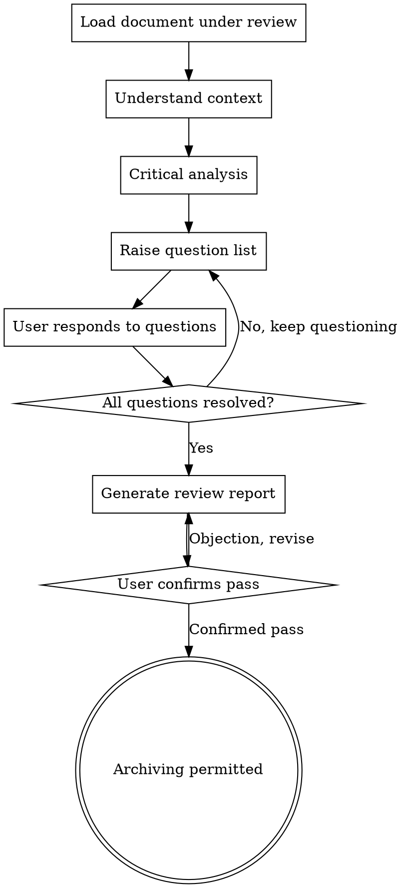

# Critical Review

## Purpose

Use this Skill for an independent critical review after the requirements document or architecture design is complete and before archiving.

**Trigger conditions**:
- The requirements document is complete; requirements-definition invokes this Skill
- The architecture design is complete; architecture-design invokes this Skill
- The user explicitly requests a critical review

**Core principle**: The reviewer is not the author and must maintain independent critical thinking

<HARD-GATE>
Before the critical review is complete and confirmed by the user, archiving the document or entering the next phase is prohibited.
</HARD-GATE>

---

## Review Flow



---

## Pre-check: Brief Generation Status Check (Must Run Before Review)

**Goal**: Ensure complex changes have completed Agent Brief generation before entering critical review.

**Trigger timing**: Every time critical-review starts (before loading the document under review).

### Check Flow

1. **Assess the change size**:
   - Read `tasks.md` and count task groups/modules/files
   - Check whether interface changes are involved (new APIs, modified function signatures)

2. **Decide whether a Brief is needed**:
   - Effort > 2 hours
   - Cross-module (≥ 2 modules)
   - File count > 3
   - Involves interface changes
   - Any condition met → Brief needed

3. **Check the Brief status**:
   - Check whether `.specgate/briefs/<change-name>.md` has been generated

4. **Handling logic**:
   ```
   Brief needed?
     ├─ Yes, and already generated → Continue the review process
     ├─ Yes, but not generated → 🔴 Interrupt the review
     │   → Prompt: "The current change size meets the Brief generation criteria, but the Brief has not been generated.
     │            Please invoke sg-skill-triage-brief to generate the Agent Brief first,
     │            and then restart the critical review. Generate it now?"
     │   → Wait for the user's decision
     └─ No (simple change) → Record the rationale and continue the review process
   ```

5. **Deviation record**:
   - If the user confirms skipping the Brief, it must be recorded in `.specgate/deviations.log`:
     ```yaml
     - timestamp: "YYYY-MM-DDTHH:MM:SSZ"
       deviation: "Skipped the G6.5 Brief generation check"
       reason: "User confirmed the skip, rationale: {reason}"
       approved_by: "user"
     ```

**Prohibited behavior**:
- ❌ Entering the review without checking the Brief status
- ❌ Discovering a missing Brief but not notifying the user
- ❌ Silently skipping the deviation record

---

## 🚫 Pre-check: Prohibit AI Self-Review

> **Added 2026-05-14**, to solve the problem of the AI replacing the formal review process with a self-serve "quick glance + drive-by bug fix".
> **Companion**: `.specgate/templates/rules/workflow-state.md` "Incremental Modification Review Gate" + `.specgate/workflow-rules.yaml` `artifact-modification-review-gate`

**Trigger condition**: The AI has made any semantic modification to artifacts that have already passed review (proposal/design/tasks/specs/*/spec.md).

### Mandatory Behavior

1. Must invoke `sg-skill-critical-review` or delegate to a read-only review subagent to perform the incremental review
2. ❌ The AI must not decide on its own that "the change is small and needs no review"
3. ❌ The AI must not scan and fix on its own and then pass the artifact directly (even if it found and fixed a problem, that does not replace review)
4. ❌ The AI must not take over the reviewer role (the reviewer is not the modifier)
5. The review conclusion must be presented to the user, awaiting explicit approval

### Correct Approach

```
> "Detected that tasks.md has been modified (S5/S9 split).
>  Per the incremental modification gate, critical-review must be re-run. Invoking the review process now…"
```

### Wrong Approach (Red Line)

```
> "I took a quick look, found no problems, and fixed an inconsistency along the way. Passed."
```
↑ This is bypassing review — replacing the formal review process with "eyeball it once + drive-by bug fix".

### Difference from a Normal critical-review

| Dimension | Normal review (first time) | Incremental review (after modification) |
|-----------|----------------------------|-----------------------------------------|
| Trigger timing | All artifacts complete for the first time | An artifact that has already passed review is modified |
| Review scope | Full (all artifacts) | Incremental (this change + affected downstream artifacts) |
| Execution requirement | Full review process | Full review process (must not be simplified!) |
| Prohibited behavior | Skipping review | Skipping review + AI self-review substitution |

**Key**: Incremental review ≠ simplified review. The process intensity is exactly the same as the first review.

---

## Critical Analysis Dimensions

### 1️⃣ Assumption Detection

**Goal**: Find implicit, unstated assumptions in the document

**Check items**:
- [ ] Does it assume that certain external systems are available?
- [ ] Does it assume user behavior patterns?
- [ ] Does it assume technical limitations?
- [ ] Does it assume that business rules will not change?
- [ ] Does it assume team capability/resources?

**Questioning script**:
```
"You mention {content} in section X. Does this assume {assumption}?
If so, what are the conditions under which this assumption holds?
What happens if the assumption does not hold?"
```

---

### 2️⃣ Edge Case Challenge

**Goal**: Discover unconsidered edge cases and abnormal scenarios

**Check items**:
- [ ] Extreme data volume scenarios (0, 1, very large values)
- [ ] Concurrency/race conditions
- [ ] Network failure/timeout
- [ ] Permission/security boundaries
- [ ] Data consistency/transaction boundaries
- [ ] Time-related scenarios (time zones, daylight saving time, leap years)

**Questioning script**:
```
"What happens to the current design if {edge case} occurs?
I see no handling strategy for this scenario in the document."
```

---

### 3️⃣ Alternative Challenge

**Goal**: Challenge the soundness of the option selection and ensure no better option was missed

**Check items**:
- [ ] Were enough options really compared?
- [ ] Are the reasons for the recommended option sufficient?
- [ ] Were any industry best practices left out?
- [ ] Could a new technology/tool solve it?

**Questioning script**:
```
"You chose option A, but I notice that {alternative} might be more suitable in {scenario}.
Why was this option not considered?"
```

---

### 4️⃣ Maintainability Challenge

**Goal**: Evaluate the long-term maintenance cost and evolution capability

**Check items**:
- [ ] Can a newcomer understand this design 6 months from now?
- [ ] If {feature} needs to be added, how many places must change?
- [ ] Is there over-engineering (violating YAGNI)?
- [ ] Is there under-design (guaranteed refactoring in the future)?
- [ ] Is the documentation sufficient?

**Questioning script**:
```
"What is the maintenance cost when this design needs modification 6 months from now?
I see that {part} may confuse future readers because {reason}."
```

---

### 5️⃣ Risk Assessment Challenge

**Goal**: Ensure risks are sufficiently identified and have mitigation strategies

**Check items**:
- [ ] Are technical risks underestimated?
- [ ] Dependency risks (third-party libraries, external APIs, team)
- [ ] Security risks (data leakage, injection, permissions)
- [ ] Performance risks (bottlenecks, scalability)
- [ ] Business risks (requirement changes, market changes)

**Questioning script**:
```
"You listed {N} risks, but I think {risk} may be underestimated.
If this risk materializes, what is the impact? What is the mitigation strategy?"
```

---

### 6️⃣ Consistency Check

**Goal**: Find contradictions within the document or with external documents

**Check items**:
- [ ] Is terminology used consistently with CONTEXT.md?
- [ ] Are the requirements document and the architecture design consistent?
- [ ] Are there contradictions between earlier and later sections?
- [ ] Are the numbers/metrics self-consistent?

**Questioning script**:
```
"You say {content A} in section X, but you say {content B} in section Y.
These appear to contradict each other; please clarify."
```

---

## Question List Format

### High Priority (Must Resolve)

| # | Dimension | Question | Location | Severity |
|---|-----------|----------|----------|----------|
| 1 | Assumption detection | Assumes availability of the external payment system | Architecture design 3.2 | 🔴 High |
| 2 | Edge cases | Concurrent order conflicts not handled | Architecture design 4.1 | 🔴 High |
| 3 | Risk assessment | Underestimates the third-party API rate-limiting risk | Architecture design 6.3 | 🔴 High |

### Medium Priority (Recommended to Resolve)

| # | Dimension | Question | Location | Severity |
|---|-----------|----------|----------|----------|
| 4 | Maintainability | OrderService has too many interface methods (8) | Architecture design 3.1 | 🟡 Medium |
| 5 | Alternatives | Event Sourcing not considered | Architecture design 2.3 | 🟡 Medium |

### Low Priority (Optional)

| # | Dimension | Question | Location | Severity |
|---|-----------|----------|----------|----------|
| 6 | Consistency | "User" and "Customer" used interchangeably | Requirements document 2.1 | 🟢 Low |

---

## User Response Flow

### After the AI Raises Questions:

```markdown
**AI**: 
"I found the following questions:

🔴 High priority 1: Assumes availability of the external payment system
- Location: Architecture design 3.2
- Problem: The design assumes the payment system is 99.9% available. What if the payment system goes down?
- Suggestion: Add a fallback strategy (e.g., local queue + asynchronous retry)

Please respond to this question:
A. Accept the suggestion and modify the document
B. Reject the suggestion, because {specific reason}
C. Partially accept, modify to {option}
D. Need further discussion"
```

### After the User Responds:

```markdown
**If the user chooses A/C**:
- The AI updates the document
- Marks the question as "Resolved"

**If the user chooses B**:
- The AI records the reason for rejection
- Marks the question as "User confirmed acceptance of the risk"
- Continues to the next question

**If the user chooses D**:
- Return to the critical analysis phase
- Re-evaluate after in-depth discussion
```

---

## Review Pass Criteria

### One of the following conditions must be met:

**Condition 1: All questions resolved**
```
- High-priority question resolution rate = 100%
- Medium-priority question resolution rate ≥ 80%
- Low-priority question resolution rate ≥ 50%
```

**Condition 2: The user confirms acceptance of the remaining risks**
```
- The user explicitly states: "I understand the remaining questions and confirm that it can pass"
- All unresolved questions are recorded in the review report
- The user understands the risk of each unresolved question
```

---

## Review Report Format

```markdown
# Critical Review Report

## Basic Information
- Document reviewed: {document path}
- Review date: {YYYY-MM-DD}
- Review type: [ ] Requirements review [ ] Architecture review

## Review Statistics
- Total questions: {N}
- High priority: {N} (resolved {N}, risk accepted {N})
- Medium priority: {N} (resolved {N}, risk accepted {N})
- Low priority: {N} (resolved {N}, risk accepted {N})

## Resolution Rates
- High-priority resolution rate: {X}%
- Medium-priority resolution rate: {X}%
- Low-priority resolution rate: {X}%
- Overall resolution rate: {X}%

## Remaining Risk List

| # | Question | User Decision | Risk Level |
|---|----------|---------------|------------|
| 1 | {question content} | Accepts the risk, because {X} | 🔴 High |

## Review Conclusion

[ ] ✅ Passed, may be archived
[ ] ⚠️ Conditionally passed, remaining risks recorded
[ ] ❌ Not passed, major revisions required

## Reviewer Statement

"I completed the critical review from an independent reviewer's perspective, and all questions have been fully discussed.
The user has understood the remaining risks and made an explicit decision."

Reviewer: AI Critical Reviewer
Date: {YYYY-MM-DD}
```

---

## Red Lines

- ❌ The reviewer is not the document's author (independence must be maintained)
- ❌ Archiving directly while skipping the critical review
- ❌ High-priority questions unresolved and the user has not confirmed acceptance of the risk
- ❌ The review report does not record the remaining risks
- ❌ The user has not explicitly confirmed "it can pass"
- ❌ The AI substitutes its own "quick glance" for a formal review (added 2026-05-14)
- ❌ After modifying an artifact, the AI fixes inconsistencies on its own and declares it passed (added 2026-05-14)
- ❌ Skipping review after an incremental modification on the grounds that "the change is small" (added 2026-05-14)

---

## Relationship with Other Skills

| Skill | Relationship | Description |
|-------|--------------|-------------|
| **requirements-definition** | Prior invocation | Invoke this Skill after the requirements document is complete |
| **architecture-design** | Prior invocation | Invoke this Skill after the architecture design is complete |
| **triage-brief** | Prerequisite | For complex changes, the Brief must be generated through triage-brief before entering critical-review |
| **terminology-management** | Dependency | Use CONTEXT.md for consistency checks |
| **experience-summarization** | Follow-up invocation | Capture experience after the review is complete |

---

**Final state**: Review report generated and confirmed by the user → the document may be archived
