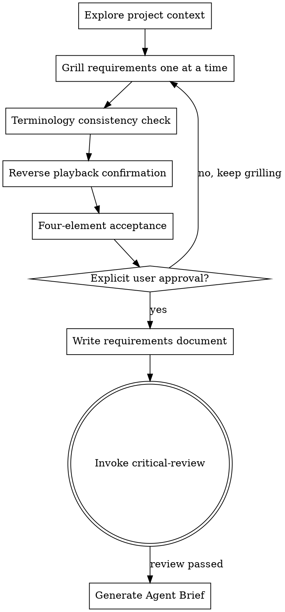

# Requirements Definition

## Purpose

Use this Skill to conduct deep requirements grilling before creating a feature, building a component, adding functionality, or modifying behavior.

**Trigger conditions**:
- The user proposes a new feature or a change request
- A requirements description is detected as vague or incomplete
- Inconsistent terminology usage is detected

<HARD-GATE>
Do not enter the architecture design phase or write code until the requirements document is complete and explicitly approved by the user.
</HARD-GATE>

---

## Core Flow



---

## Process Details

### 1. Explore Project Context

**Goal**: Understand the current project state

**Actions**:
- Inspect the project file structure
- Read README and CONTEXT.md (if present)
- Review recent commits
- Identify existing architectural patterns

---

### 2. Grill Requirements One at a Time

**Core principle**: One question at a time; wait for feedback before continuing

**Grilling checklist** (choose as needed, do not ask everything at once):

#### 2.1 Purpose and Value (What & Why)
- "What problem does this feature solve?"
- "Who will use this feature?"
- "What are the success criteria?"

#### 2.2 Constraints and Boundaries
- "What technical constraints exist?"
- "Which existing systems must this integrate with?"
- "What are the performance/security/compliance requirements?"

#### 2.3 Edge Cases (Intensified)

**Core principle**: Invent extreme scenarios to force the user to define boundaries precisely

**Scenario design techniques**:

1. **Concurrency conflicts**
   - "What happens if two users cancel the same order at the same time?"
   - "What happens if two approvers act at the same time in an approval workflow?"

2. **Extreme data**
   - "If there are 1 million order items, will your design still work?"
   - "What happens if a single request contains 1000 data points?"

3. **Time boundaries**
   - "If an order is cancelled at midnight 12:00:00, does it count as that day or the next day?"
   - "How are cross-time-zone operations handled?"

4. **State conflicts**
   - "If an order is marked both 'shipped' and 'cancelled', how does the system handle it?"
   - "If some approvers approve and others reject in an approval workflow, what is the final state?"

5. **Permission boundaries**
   - "Customer service can cancel orders, but can they cancel shipped orders?"
   - "Can regular users see admin operation logs?"

6. **Network anomalies**
   - "What happens if the payment callback is delayed by 10 seconds?"
   - "If the database connection times out, will data be lost?"

7. **Data inconsistency**
   - "If the cache and the database disagree, which one wins?"
   - "If the message queue consumes a message twice, will it create duplicate orders?"

**Requirements**:
- Invent at least 2 extreme scenarios for each core concept
- Scenarios must be concrete; do not use vague descriptions like "what if something goes wrong"
- Force the user to give a precise handling strategy; "we'll see when we get there" is not acceptable

#### 2.4 Terminology Clarification
- "You said 'account' — do you mean Customer or User?"
- "Does 'order cancellation' mean the entire Order or some OrderItems?"
- "Is this 'approval' the same concept as the 'review' you mentioned earlier?"

#### 2.5 Code Cross-Validation (Critical)

**Core principle**: Do not trust the user's description; verify against the code

**Trigger points**:
- When the user describes the behavior of existing functionality
- When the user describes technical constraints
- When the user describes integration interfaces
- When the user describes the system architecture

**Actions**:
```
When the user says X:
  1. Use read to read the relevant code
  2. Use grep to search for the key implementation
  3. Verify whether the code matches the user's description
  4. Point out contradictions immediately
```

**Examples**:
- The user says: "Orders can be partially cancelled" 
  → Check the code: `grep("cancel.*order", type="ts")`
  → Found: the code only supports cancelling the entire order
  → Point out: "You said orders can be partially cancelled, but the code shows Order.cancel() cancels the entire order — which is correct?"

- The user says: "The approval workflow has 3 levels"
  → Check the code: `read("src/workflow/approval.ts")`
  → Found: there are actually only 2 levels
  → Point out: "You said there are 3 approval levels, but ApprovalWorkflow in the code only defines 2 — does it need to be extended to 3 levels?"

- The user says: "We use Redis for caching"
  → Check the code: `grep("redis|Redis", type="ts")`
  → Found: there is no Redis dependency
  → Point out: "You said Redis, but package.json has no Redis dependency — is it planned, or did you misremember?"

**Red lines**:
- ❌ Do not trust the user's verbal description
- ❌ Do not skip code verification
- ✅ Speak with code facts

---

### 3. Terminology Consistency Check

**Goal**: Ensure the unified domain language in CONTEXT.md is used

**Lazy creation principle** (critical):
- ✅ Create CONTEXT.md only when the first term is resolved
- ❌ Do not create an empty document before grilling starts
- ❌ Do not create CONTEXT.md before the terminology is clarified

**Actions**:

#### 3.1 Check CONTEXT.md
```
If CONTEXT.md exists:
  1. Read all defined terms
  2. Scan the terms used in the user's description
  3. Point out conflicts immediately

If CONTEXT.md does not exist:
  1. Read the system template: specgate/templates/CONTEXT.md
  2. Create CONTEXT.md using the template format
  3. Write the first resolved term
```

#### 3.2 Handling New Terms
```
If a new term is found:
  1. Ask the user for the definition
  2. Confirm the Chinese translation
  3. List the aliases to avoid
  4. Update CONTEXT.md immediately
```

---

### 4. Reverse Playback Confirmation

**Goal**: Verify that the AI's understanding matches the user's intent

**Actions**:

The AI must restate the following, and the user confirms each item:

```markdown
Let me confirm my understanding:

1. The core problem you want to solve is: {problem}
2. The target users are: {users}
3. The success criteria are: {verifiable criteria}
4. The key constraints are: {constraints}
5. The main edge cases are: {edge cases}

Is my understanding correct? Is anything missing or wrong?
```

**User response**:
- ✅ Completely correct → Proceed to four-element acceptance
- ⚠️ Mostly correct, but... → Clarify and continue
- ❌ Several things are wrong → Return to the grilling phase

---

### 5. Four-Element Acceptance

**Goal**: Ensure the requirements document meets the quality bar

#### Element 1: Zero terminology ambiguity
- [ ] All core terms are defined in CONTEXT.md
- [ ] Each term has: English name, Chinese translation, definition, aliases to avoid
- [ ] No unresolved terminology conflicts
- [ ] The user explicitly confirms: "The terminology definitions are accurate"

**Quantitative metrics**:
- Terminology coverage = defined terms / total terms used in the requirements = **must be 100%**
- Number of terminology conflicts = **must be 0**

#### Element 2: Verifiable requirements
- [ ] Every requirement has clear success criteria
- [ ] Success criteria include measurable metrics
- [ ] At least 3 edge cases are identified with handling strategies
- [ ] Every success criterion can be converted into a test case

**Quantitative metrics**:
- Number of vague requirements (ones for which no test case can be written) = **must be 0**
- Number of edge cases identified ≥ **3** (simple requirements) / **5** (complex requirements)

#### Element 3: Reverse playback passed
- [ ] The AI restates the 5 items (problem, users, criteria, constraints, boundaries)
- [ ] The user confirms each item
- [ ] Pass rate = **must be 100%**

#### Element 4: Explicit approval
- [ ] The user approves using one of the following explicit statements:
    ✅ "I approve this requirements document"
    ✅ "The requirements are confirmed; we can proceed to the architecture design phase"
    ✅ "Approved"
  
- [ ] Vague confirmations are not accepted:
    ❌ "OK" / "Sure" / "Fine" / "Mm"
    ❌ A like emoji only
    ❌ Silence (no reply for more than 2 minutes)

---

### 6. ADR Creation Decision (Critical)

**Core principle**: Create an ADR only when all three conditions are satisfied at the same time

**When to create an ADR**:

You must **simultaneously satisfy** the following three conditions:

1. **Hard to reverse**
   - The cost of changing your mind is high
   - Example: choosing a database type, architectural style, or core algorithm
   - Counter-example: variable naming, function placement, UI colors

2. **Surprising without context**
   - Future readers will wonder "why was it done this way?"
   - Example: why Redis instead of Memcached, why event sourcing
   - Counter-example: using standard design patterns, following best practices

3. **Result of a real trade-off**
   - There were real alternatives, and one was chosen for specific reasons
   - Example: performance vs. maintainability, consistency vs. availability
   - Counter-example: only one viable option, no room to choose

**Decision flow**:
```
A significant decision point emerges during grilling
  ↓
Check the three conditions:
  ├─ Hard to reverse?
  ├─ Surprising without context?
  └─ Result of a real trade-off?
  ↓
Are all three satisfied?
  ├─ Yes → Create an ADR (docs/adr/YYYY-MM-DD-{decision}.md)
  └─ No → Only update CONTEXT.md, skip the ADR
```

**ADR template**:
```markdown
# ADR-{number}: {decision title}

**Date**: YYYY-MM-DD  
**Status**: Accepted | Deprecated | Superseded

## Context
{Why this decision needs to be made}

## Decision
{We decided to...}

## Alternatives Considered

### Option 1: {name}
- Pros:
- Cons:

### Option 2: {name}
- Pros:
- Cons:

## Rationale
{Why this option was chosen}

## Consequences
{The impact of this decision}
```

**Examples**:

✅ **An ADR should be created**:
- "We chose PostgreSQL over MongoDB because we need strong consistency"
- "We use event sourcing because we need a complete audit log"
- "We chose gRPC over REST because of performance requirements"

❌ **An ADR should not be created**:
- "We use TypeScript" (already decided by the project)
- "We use const instead of var" (language best practice)
- "Function names use camelCase" (coding convention)

**Red lines**:
- ❌ Do not create an ADR for every decision
- ❌ Do not create an ADR when the three conditions are not satisfied
- ✅ Keep ADRs concise and focused on the decision itself

---

### 7. Write the Requirements Document

**Goal**: Persist the approved requirements

**Lazy creation principle** (critical):
- ✅ Create it only after all grilling is complete and four-element acceptance has passed
- ❌ Do not create drafts during grilling
- ❌ Do not create the document before the requirements are approved

**File location**: `docs/requirements/YYYY-MM-DD-{topic}-requirements.md`

**Requirements document structure**:
```markdown
# {Feature name} Requirements Document

## Overview
One-sentence description

## Background
- Problem being solved
- User needs
- Business value

## Target Users
{User personas}

## Success Criteria
{Measurable metrics}

## Functional Requirements
### Requirement 1: {name}
- Description:
- Priority: P0/P1/P2
- Success criteria:
- Edge cases:

### Requirement 2: {name}
- (same as above)

## Constraints and Boundaries
- Technical constraints:
- Integration requirements:
- Performance requirements:
- Security requirements:

## Terminology Definitions
{Reference the relevant terms in CONTEXT.md}

## Edge Case Handling
{Identified edge cases and their handling strategies}
```

---

### 7.5 G1 Gate Confirmation (Explicit Confirmation Step)

**Trigger condition**: The requirements document has been written and has passed critical-review

**The AI must do the following**:

1. Output the standard G1 confirmation question (per the confirmation format rules in gate-control.md):
   ```
   The requirements document is complete and has passed the critical review.

   Please confirm:
   - Is the requirements understanding correct?
   - Can we proceed to the change classification (G2) phase?

   Reply "pass"/"confirm" to continue, or "needs changes" to go back and revise.
   ```

2. **Must** wait for an explicit user reply ("pass"/"confirm"/"yes"/"needs changes")

3. After receiving confirmation, create the G1 gate marker file:
   ```bash
   mkdir -p .specgate/gates
   printf '{"gate":"G1","confirmedAt":"%s","confirmedBy":"user"}\n' \
     "$(date -u +%Y-%m-%dT%H:%M:%SZ)" > .specgate/gates/G1.confirmed
   ```

4. **Prohibited** before obtaining explicit user confirmation:
   - ❌ Entering the change classification phase
   - ❌ Creating proposal.md
   - ❌ Writing any code

**Confirmation format rules** (per gate-control.md):
- Must: use an explicit interrogative sentence
- Must: wait for an explicit user reply
- Prohibited: using a declarative sentence instead of a question
- Prohibited: assuming the user agrees

---

### 8. Transition to Critical Review

**Next step**: Invoke `sg-skill-critical-review` for an independent review

**The AI must comply**:
1. The requirements document has been committed to git
2. CONTEXT.md has been updated (if there are new terms)
3. Invoke critical-review for the critical review

**Prohibited**:
- ❌ Entering the architecture design phase directly
- ❌ Skipping the critical review
- ❌ Writing code

---

### 9. Generate the Agent Brief (after the requirements review passes)

**Trigger condition**: critical-review has passed and the requirements document has received the user's final confirmation

**Goal**: Turn the requirements into an executable, structured task description that provides clear guidance for the implementation phase

**Actions**:

#### 8.1 Assess Requirements Complexity

Assess the following indicators:
- **Effort**: estimated implementation time > 2 hours
- **Cross-module**: involves changes to more than 2 modules
- **File count**: more than 3 files need to be changed
- **Interface changes**: involves API/function signature changes

**Decision**:
- ✅ Any condition met → Generate an Agent Brief
- ❌ None met → The Brief can be skipped (simple change)

#### 8.2 Invoke the triage-brief Skill

```markdown
1. Invoke the `sg-skill-triage-brief` Skill
2. Generate the Brief based on the approved requirements document
3. The Brief must include:
   - Summary (1-2 sentences on what to do + why)
   - Current behaviour (current state)
   - Desired behaviour (desired state)
   - Key interfaces (core interfaces)
   - Acceptance criteria (Given/When/Then format)
   - Out of scope (explicitly state what is not being done)
   - Reference files (file paths)
   - Constraints (constraint conditions)
4. **Run the information loss check** (performed automatically by triage-brief)
   - Extract 10 categories of key information points from the requirements document
   - Check Brief coverage item by item
   - Assess missing risk (high/medium/low)
   - Automatically fill in high-risk gaps
   - Generate a check report
```

#### 8.4 Review the Information Loss Check Report

**The AI must**:
1. Show the check report generated by triage-brief
2. Emphasize:
   - High-risk gaps (if any, already filled in automatically)
   - Medium-risk gaps (the user must decide)
   - Low-risk gaps (acceptable)
3. Ask the user: "The check report shows X medium-risk gaps. Do they need to be added to the Brief?"

**User approval criteria**:
- ✅ "The check passed, no additions needed" → Proceed to saving the Brief
- ⚠️ "Add X items" → Update the Brief and re-run the check
- ❌ "Regenerate the Brief" → Start over from 8.2

---

#### 8.5 Save the Brief

**Storage location**: `.specgate/briefs/<feature-name>.md`

**Naming convention**:
- Use lowercase English
- Separate words with `-`
- Examples: `user-authentication.md`, `order-cancellation.md`

**Directory structure**:
```
.specgate/
├── briefs/
│   ├── user-authentication.md
│   ├── order-cancellation.md
│   └── ...
├── out-of-scope/
└── templates/
```

#### 8.6 User Confirmation

**The AI must**:
1. Show the generated Brief content
2. Ask the user: "Does the Brief accurately reflect the requirements? Is any key information missing?"
3. Wait for user confirmation or change requests
4. Update the Brief based on the feedback

**User approval criteria**:
- ✅ "The Brief is accurate" → Proceed to the architecture design phase
- ⚠️ "X needs changing" → Update the Brief and re-confirm
- ❌ "Rewrite the Brief" → Regenerate it

---

## Anti-Patterns

### Anti-Pattern 1: "This is too simple to need grilling"

**Wrong**: Skipping grilling and implementing directly

**Right**: All requirements go through this process. To-do lists, single-feature tools, config changes — no exceptions. "Simple" requirements are where unreviewed assumptions cause the most wasted work. Grilling can be short (a few questions for genuinely simple items), but you must present the design and get approval.

---

### Anti-Pattern 2: Asking all questions at once

**Wrong**:
```
"Please answer the following questions:
1. What is the purpose of this feature?
2. Who are the target users?
3. What are the constraints?
4. What are the success criteria?
..."
```

**Right**: One question at a time; wait for the user's answer before asking the next.

---

### Anti-Pattern 3: Skipping the terminology check

**Wrong**: The user says "account" and the AI uses it directly without confirming whether it means Customer or User

**Right**: Point out the ambiguity immediately, require clarification, and update CONTEXT.md

---

### Anti-Pattern 4: Accepting vague approval

**Wrong**: Treating "OK" as approval

**Right**: Explicit approval is required ("I approve this requirements document")

---

## Key Principles

1. **One question at a time** — do not overwhelm the user with multiple questions
2. **Terminology consistency** — point out conflicts immediately and update new terms immediately
3. **Code cross-validation** — do not trust the user's description; verify against the code
4. **Strictly follow YAGNI** — remove unnecessary features from all designs
5. **Reverse playback** — restate your understanding in your own words to ensure alignment
6. **Four-element acceptance** — zero terminology ambiguity, verifiable requirements, reverse playback passed, explicit approval
7. **Stay flexible** — when something is unclear, go back and clarify
8. **Critical review** — the requirements document must undergo an independent review once complete
9. **Lazy file creation** — create files only when needed, never prematurely
10. **Strict ADR criteria** — create an ADR only when all three conditions are satisfied
11. **Agent Brief** — after a complex requirement is reviewed, a Brief must be generated as implementation guidance
12. **G1 gate marker** — after the user explicitly confirms G1, the `.specgate/gates/G1.confirmed` marker file must be created; the DSH plugin guard relies on this marker for subsequent gate checks

---

## Red Lines

- ❌ Skipping grilling and implementing directly
- ❌ Asking all questions at once
- ❌ Ignoring terminology conflicts
- ❌ Skipping code cross-validation
- ❌ Entering the next phase without explicit approval
- ❌ Skipping the critical review
- ❌ Approving when four-element acceptance has not passed
- ❌ Creating an ADR for a decision that does not satisfy the three conditions
- ❌ Creating documents prematurely during grilling
- ❌ Skipping Brief generation for complex requirements (required when effort > 2 hours)
- ❌ Failing to create the `.specgate/gates/G1.confirmed` marker file after the user confirms G1

---

## Relationship with Other Skills

| Skill | Relationship | Description |
|-------|------|------|
| **terminology-management** | Dependency | Uses CONTEXT.md for terminology checks |
| **critical-review** | Subsequent call | The only permitted step after the requirements document is approved |
| **triage-brief** | Subsequent call | After critical-review passes, complex requirements must generate a Brief |
| **architecture-design** | Subsequent call | Entered after the Brief is generated (or directly for simple requirements, skipping the Brief) |
| **domain-modeling** | Optional call | If DDD modeling is needed, call it after grilling |

---

**The final state is invoking critical-review, and after it passes, generating an Agent Brief (for complex requirements).** Do not enter the architecture design phase until the requirements document is complete and explicitly approved by the user.
