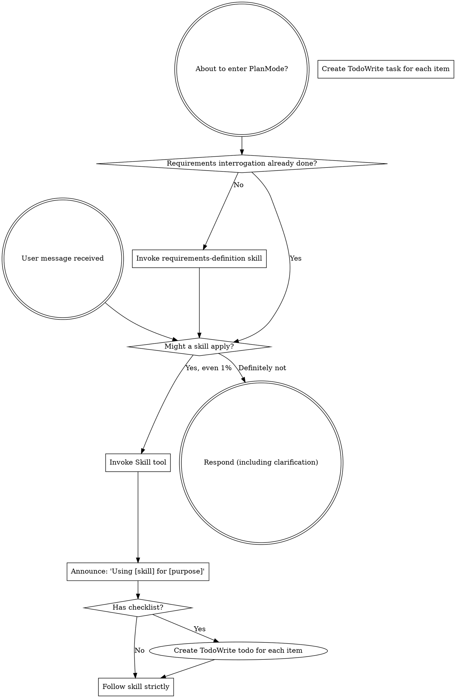

<EXTREMELY-IMPORTANT>
If you think there is even a 1% chance that a Skill applies to your current work, you absolutely must invoke that Skill.

If a Skill applies to your task, you have no choice. You must use it.

This is not negotiable. This is not optional. You cannot make excuses to bypass it.
</EXTREMELY-IMPORTANT>

## SpecGate Skill System Overview

The DSH version of the plugin registers **30** Skills (`sg-core` 12, `engineering` 11, `productivity` 4, `misc` 3). All Skills are registered by the plugin into the DSH skill catalog at session start; there is no dependency on `.qoder` or Hooks.

### Core Workflow (sg-core)

- `sg-skill-entry-guard` — Entry triage (Q&A / lightweight / heavyweight)
- `sg-skill-change-classification` — Change classification (L1/L2/L3)
- `sg-skill-requirements-definition` — Requirements definition
- `sg-skill-critical-review` — Critical review
- `sg-skill-vertical-slicing` — Vertical slicing
- `sg-skill-triage-brief` — Task brief
- `sg-skill-doctor-analysis` — Project health check
- `sg-skill-anti-patterns` — Anti-pattern quick reference
- `sg-skill-experience-summarization` — Experience capture
- `sg-skill-knowledge-retrieval` — Knowledge retrieval
- `sg-skill-knowledge-research` — Knowledge research
- `sg-using-skills` — This guide

### Engineering and Delivery (engineering / productivity)

- Design: `sg-skill-architecture-design`, `sg-skill-domain-modeling`, `sg-skill-harness-design`, `sg-skill-improve-architecture`
- Implementation: `sg-skill-test-driven-development`, `sg-skill-systematic-debugging`, `sg-skill-writing-plans`, `sg-skill-executing-plans`
- Quality: `sg-skill-code-review`, `sg-skill-writing-skills`
- Git: `sg-skill-using-git-worktrees`, `sg-skill-finishing-a-development-branch`

### Other (misc)

- `sg-skill-prototype`, `sg-skill-terminology-management`, `sg-skill-zoom-out`

## How to Access Skills

**In DSH:** Invoke the `skill` tool directly with the Skill name (for example, `skill sg-skill-entry-guard`). After loading, follow its content; do not read Skill files line by line with the `read` tool.

**Skill location**: `.dsh/skills/specgate/<skill-name>/SKILL.md` (materialized by `/sg-init`; the plugin also registers all 30 Skills in memory).

# Using Skills

## Rules

**Before any response or action, invoke the relevant or requested Skill.** Even if a Skill has only a 1% chance of applying, you should invoke it to check. If the invoked Skill ultimately does not apply to the current situation, you do not need to use it.



## Red Flags

These thoughts mean stop — you are making excuses:

| Thought | Reality |
|---------|---------|
| "This is just a simple question" | A question is a task. Check skills. |
| "I need more context first" | Skill checks come before clarifying questions. |
| "Let me explore the codebase first" | Skills tell you how to explore. Check first. |
| "I can quickly check git/files" | Files lack conversational context. Check skills. |
| "Let me gather information first" | Skills tell you how to gather information. |
| "This doesn't need a formal skill" | If a skill exists, use it. |
| "I remember this skill" | Skills evolve. Read the current version. |
| "This doesn't count as a task" | Action = task. Check skills. |
| "This skill is overkill" | Simple things become complicated. Use it. |
| "I'll do this one thing first" | Check before doing anything. |
| "This feels productive" | Undisciplined action wastes time. Skills prevent this. |
| "I know what that means" | Knowing the concept ≠ using the skill. Invoke it. |

## Skill Priority

When multiple skills may apply, use this order:

### 1. Requirements and Design Phase (must run first)

**Process skills** - these determine how to approach the task:
- `requirements-definition` - Requirements definition (before creative work)
- `terminology-management` - Terminology management (works with requirements-definition)
- `critical-review` - Critical review (before document approval)

**Examples**:
- "Let's build X" → requirements-definition first, then architecture-design
- "Modify this feature" → requirements-definition first, then critical-review

### 2. Spec Generation Phase (after requirements approval)

**OpenSpec commands** (not Skills) — carried by DSH commands and the `openspec/` directory:
- `/sg-propose <name>` - Create the change skeleton (requires G1/G2)
- `/sg-apply <name> --plan` - View the parallel task plan
- `/sg-apply <name>` - Execute the implementation; split into waves by `[P]`/`depends`, with at most 4 Agents and an independent worktree per task
- `/sg-archive <name>` - Archive (requires G9)

**Examples**:
- Requirements charter approved → run `/sg-propose add-login`
- Requirements are vague and need in-depth analysis → first clarify with `sg-skill-requirements-definition`, then propose

### 3. Implementation Phase (after Spec approval)

**Code quality skills** - these safeguard code quality:
- `test-driven-development` - TDD (mandatory before writing code)
- `using-git-worktrees` - Git isolation (before implementation)

**Examples**:
- Start coding → TDD first, then write the implementation

### 4. Execution and Verification Phase

**Plan execution skills** - these guide the implementation process:
- `writing-plans` - Write plans (complex tasks)
- `executing-plans` - Execute plans (when a written plan exists)

**Examples**:
- Multi-step task → writing-plans first, then executing-plans

### 5. Merge Phase

**Code review skills** - these safeguard merge quality:
- `sg-skill-code-review` - Code review (before merge)
- `finishing-a-development-branch` - Finish the branch

**Examples**:
- Task complete → sg-skill-code-review
- Review passed → finishing-a-development-branch

## Skill Types

**Rigid** (TDD, debugging, requirements-definition): Follow strictly. Do not evade discipline through adaptation.

**Flexible** (patterns, exploration): Adapt the principles to the context.

The Skill itself will tell you which type it is.

## Complete Workflow Examples

### Scenario 1: New Feature Development

```
User requirement: "Add user authentication"
  ↓
1. requirements-definition (requirements definition)
  ↓
2. terminology-management (update CONTEXT.md)
  ↓
3. architecture-design (architecture design)
  ↓
4. critical-review (critical review)
  ↓
5. /sg-propose (generate the Spec skeleton)
  ↓
6. using-git-worktrees (create an isolated branch)
  ↓
7. test-driven-development (write tests with TDD)
  ↓
8. Implement the code
  ↓
9. sg-skill-code-review (request review)
  ↓
10. finishing-a-development-branch (finish the branch)
```

### Scenario 2: Bug Fix

```
User report: "Login fails with error 500"
  ↓
1. systematic-debugging (systematic debugging, trace the root cause)
  ↓
2. test-driven-development (write a reproduction test first)
  ↓
3. Fix the code
  ↓
4. sg-skill-code-review (request review)
```

### Scenario 3: Refactoring

```
User requirement: "Refactor the order service to improve performance"
  ↓
1. requirements-definition (clarify the refactoring scope and goals)
  ↓
2. critical-review (review the refactoring approach)
  ↓
3. /sg-propose (generate the refactoring Spec skeleton)
  ↓
4. test-driven-development (ensure test coverage)
  ↓
5. sg-skill-code-review (request review)
```

## User Instructions

Instructions state what to do (WHAT), not how to do it (HOW). "Add X" or "Fix Y" does not mean skipping the workflow.

**Always follow**:
1. Check whether an applicable Skill exists
2. Invoke the Skill and follow it strictly
3. Complete all necessary steps before declaring completion
