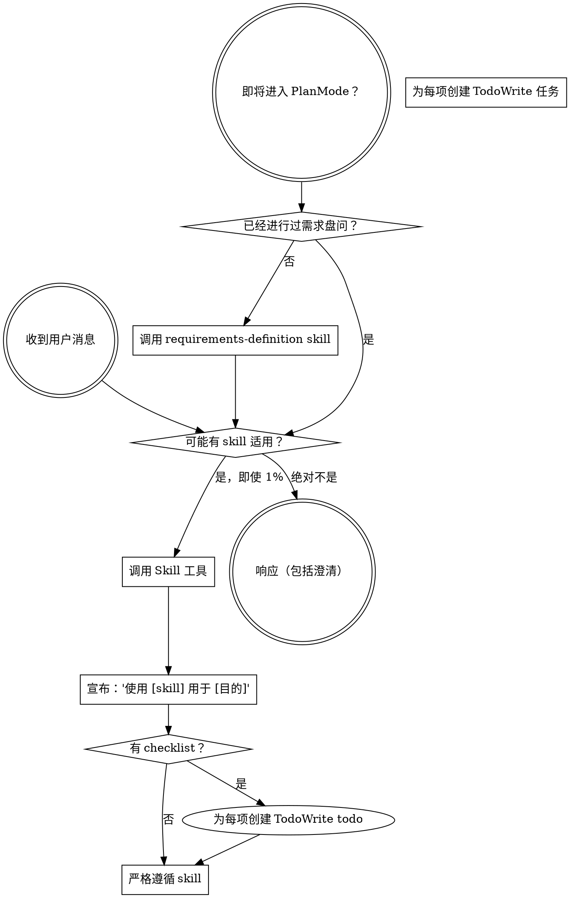

<EXTREMELY-IMPORTANT>
如果你认为某个 Skill 有哪怕 1% 的可能性适用于你当前的工作，你绝对必须调用该 Skill。

如果某个 Skill 适用于你的任务，你没有选择权。你必须使用它。

这不是可以商量的。这不是可选的。你不能找借口绕过它。
</EXTREMELY-IMPORTANT>

## specgate 技能体系概览

DSH 版插件注册 **30 个** Skill（`sg-core` 12、`engineering` 11、`productivity` 4、`misc` 3）。所有 Skill 由插件在会话启动时注册到 DSH 技能目录，无需依赖 `.qoder` 或 Hook。

### 核心流程（sg-core）

- `sg-skill-entry-guard` — 入口判定（答疑 / 轻量 / 重量）
- `sg-skill-change-classification` — 变更分类（L1/L2/L3）
- `sg-skill-requirements-definition` — 需求定义
- `sg-skill-critical-review` — 批判性审核
- `sg-skill-vertical-slicing` — 垂直切片
- `sg-skill-triage-brief` — 任务简报
- `sg-skill-doctor-analysis` — 项目健康体检
- `sg-skill-anti-patterns` — 反模式速查
- `sg-skill-experience-summarization` — 经验沉淀
- `sg-skill-knowledge-retrieval` — 知识检索
- `sg-skill-knowledge-research` — 知识调研
- `sg-using-skills` — 本指南

### 工程与交付（engineering / productivity）

- 设计：`sg-skill-architecture-design`、`sg-skill-domain-modeling`、`sg-skill-harness-design`、`sg-skill-improve-architecture`
- 实施：`sg-skill-test-driven-development`、`sg-skill-systematic-debugging`、`sg-skill-writing-plans`、`sg-skill-executing-plans`
- 质量：`sg-skill-code-review`、`sg-skill-writing-skills`
- Git：`sg-skill-using-git-worktrees`、`sg-skill-finishing-a-development-branch`

### 其他（misc）

- `sg-skill-prototype`、`sg-skill-terminology-management`、`sg-skill-zoom-out`

## 如何访问 Skill

**在 DSH 中：** 直接调用 `skill` 工具并传入 Skill 名称（例如 `skill sg-skill-entry-guard`）。加载后按内容执行；不要用 `read` 工具逐行读取 Skill 文件。

**Skill 位置**：`.dsh/skills/specgate/<skill-name>/SKILL.md`（由 `/sg-init` 物化；插件同时以内存方式注册全部 30 个 Skill）。

# 使用 Skill

## 规则

**在任何响应或行动之前，调用相关或被请求的 Skill。** 即使某个 Skill 只有 1% 的可能性适用，你也应该调用它来检查。如果调用的 Skill 最终不适用于当前情况，你不需要使用它。



## 危险信号

这些想法意味着停止——你正在找借口：

| 想法 | 现实 |
|---------|---------|
| "这只是个简单的问题" | 问题就是任务。检查 skills。 |
| "我需要先了解更多上下文" | Skill 检查在澄清问题之前。 |
| "让我先探索一下代码库" | Skills 告诉你如何探索。先检查。 |
| "我可以快速查看 git/文件" | 文件缺乏对话上下文。检查 skills。 |
| "让我先收集信息" | Skills 告诉你如何收集信息。 |
| "这不需要正式的 skill" | 如果 skill 存在，使用它。 |
| "我记得这个 skill" | Skills 会演进。阅读当前版本。 |
| "这不算任务" | 行动 = 任务。检查 skills。 |
| "这个 skill 杀鸡用牛刀" | 简单的事情会变复杂。使用它。 |
| "我先做这一件事" | 在做任何事情之前先检查。 |
| "这感觉很有成效" | 无纪律的行动浪费时间。Skills 防止这种情况。 |
| "我知道那是什么意思" | 知道概念 ≠ 使用 skill。调用它。 |

## Skill 优先级

当多个 skills 可能适用时，使用此顺序：

### 1. 需求与设计阶段（必须最先执行）

**流程 skills** - 这些决定如何着手任务：
- `requirements-definition` - 需求定义（创造性工作前）
- `terminology-management` - 术语管理（与 requirements-definition 配合）
- `critical-review` - 批判性审核（文档批准前）

**示例**：
- "让我们构建 X" → 先 requirements-definition，然后 architecture-design
- "修改这个功能" → 先 requirements-definition，然后 critical-review

### 2. Spec 生成阶段（需求批准后）

**OpenSpec 命令**（不是 Skill）——由 DSH 命令与 `openspec/` 目录承载：
- `/sg-propose <name>` - 创建 change 骨架（需 G1/G2）
- `/sg-apply <name> --plan` - 查看并行任务计划
- `/sg-apply <name>` - 执行实现；按 `[P]`/`depends` 分波次，最多 4 个 Agent、每任务独立 worktree
- `/sg-archive <name>` - 归档（需 G9）

**示例**：
- 需求宪法文档已批准 → 执行 `/sg-propose add-login`
- 需求模糊需要深入分析 → 先用 `sg-skill-requirements-definition` 澄清，再 propose

### 3. 实施阶段（Spec 批准后）

**代码质量 skills** - 这些保障代码质量：
- `test-driven-development` - TDD（编写代码前必须）
- `using-git-worktrees` - Git 隔离（实施前）

**示例**：
- 开始编码 → 先 TDD，再写实现

### 4. 执行与验证阶段

**计划执行 skills** - 这些指导实施流程：
- `writing-plans` - 编写计划（复杂任务）
- `executing-plans` - 执行计划（有书面计划时）

**示例**：
- 多步骤任务 → 先 writing-plans，再 executing-plans

### 5. 合并阶段

**代码审查 skills** - 这些保障合并质量：
- `sg-skill-code-review` - 代码审查（合并前）
- `finishing-a-development-branch` - 完成分支

**示例**：
- 任务完成 → sg-skill-code-review
- 审查通过 → finishing-a-development-branch

## Skill 类型

**刚性**（TDD、debugging、requirements-definition）：严格遵循。不要通过适配来规避纪律。

**灵活**（patterns、exploration）：将原则适配到上下文中。

Skill 本身会告诉你属于哪种。

## 完整工作流示例

### 场景 1：新功能开发

```
用户需求："添加用户认证功能"
  ↓
1. requirements-definition（需求定义）
  ↓
2. terminology-management（更新 CONTEXT.md）
  ↓
3. architecture-design（架构设计）
  ↓
4. critical-review（批判性审核）
  ↓
5. /sg-propose（生成 Spec 骨架）
  ↓
6. using-git-worktrees（创建隔离分支）
  ↓
7. test-driven-development（TDD 编写测试）
  ↓
8. 实施代码
  ↓
9. sg-skill-code-review（请求审查）
  ↓
10. finishing-a-development-branch（完成分支）
```

### 场景 2：Bug 修复

```
用户报告："登录失败，错误 500"
  ↓
1. systematic-debugging（系统调试，追溯根因）
  ↓
2. test-driven-development（先写复现测试）
  ↓
3. 修复代码
  ↓
4. sg-skill-code-review（请求审查）
```

### 场景 3：重构

```
用户需求："重构订单服务，提升性能"
  ↓
1. requirements-definition（明确重构范围和目标）
  ↓
2. critical-review（审查重构方案）
  ↓
3. /sg-propose（生成重构 Spec 骨架）
  ↓
4. test-driven-development（确保测试覆盖）
  ↓
5. sg-skill-code-review（请求审查）
```

## 用户指令

指令说明做什么（WHAT），而不是怎么做（HOW）。"添加 X" 或 "修复 Y" 并不意味着跳过工作流。

**始终遵循**：
1. 检查是否有适用的 Skill
2. 调用 Skill 并严格遵循
3. 完成所有必要步骤后再声明完成
